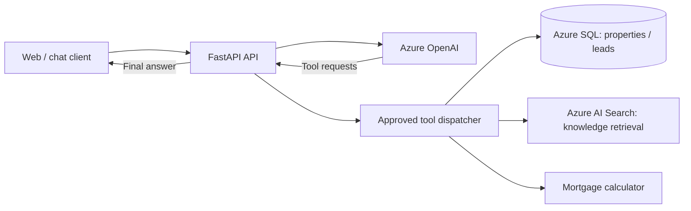

# Aqarmind — AI Real Estate Advisor | Backend

**Python · FastAPI · Azure OpenAI · Azure AI Search · Azure SQL · LLM Function Calling · Docker**

Aqarmind is an AI-powered real estate advisory platform for conversational property discovery, comparisons, mortgage estimates, and lead engagement. This repository is a **public, sanitized reference implementation** of its Python backend, focused on how language-model reasoning connects to deterministic tools, structured data, and retrieval services.

**[Product website](https://www.aqarmind.com/)** · [Architecture](docs/architecture.md) · [API examples](docs/api-examples.md) · [Implementation scope](docs/implementation-scope.md)

> **Scope:** The public code is intentionally smaller than the complete Aqarmind application. It does not include production credentials, customer data, proprietary configuration, or the full tenant-aware RAG implementation. See [what is—and is not—implemented here](docs/implementation-scope.md).

## At a glance

| Engineering area | Demonstrated in this repository |
| --- | --- |
| **LLM integration** | Azure OpenAI chat completions with approved function/tool calls |
| **Structured search** | Parameterized Azure SQL queries for property discovery |
| **Knowledge retrieval** | Azure AI Search text retrieval, with optional semantic ranking |
| **Deterministic tools** | Mortgage calculations performed in Python, not generated by the LLM |
| **API engineering** | FastAPI, Pydantic validation, modular services, OpenAPI documentation |
| **Security fundamentals** | Environment-based secrets, consent validation, input-size limits, safe error responses |
| **Developer workflow** | Unit/API tests, GitHub Actions CI, example configuration, Dockerfile |

## How it works



**The central design choice:** use SQL for structured property facts, Azure AI Search for textual knowledge, and Python for financial calculations. The model selects approved tools; backend code executes them. [Read the design walkthrough →](docs/architecture.md)

## API surface

| Method | Endpoint | Purpose |
| --- | --- | --- |
| `GET` | `/health` | Process health check (no cloud connection required) |
| `GET` | `/config-check` | Configuration-presence booleans only |
| `GET` | `/properties` | List property records from Azure SQL |
| `POST` | `/search-properties` | Filter property inventory |
| `POST` | `/mortgage` | Calculate an illustrative payment |
| `POST` | `/knowledge-context` | Retrieve documents from Azure AI Search |
| `POST` | `/chat` | Generate an LLM response, including supported tool calls |
| `POST` | `/leads` | Save a consented lead to Azure SQL |

Only `/health`, `/config-check`, and `/mortgage` work without configuring external Azure services. Other endpoints require their corresponding service credentials and resources. Try example payloads in [API examples](docs/api-examples.md).

## Run locally

**Requirements:** Python 3.11+, with the Microsoft ODBC Driver 18 for SQL Server installed if you plan to use SQL endpoints. Azure resources are needed for AI, search, and database operations.

```bash
python -m venv .venv
# Windows PowerShell: .\.venv\Scripts\Activate.ps1
# macOS/Linux: source .venv/bin/activate
python -m pip install -r requirements.txt
```

Copy `.env.example` to `.env` and set your **own development** configuration. Never commit `.env`.

```bash
uvicorn app.main:app --reload
```

Open **http://127.0.0.1:8000/docs** for the interactive Swagger API documentation.

Try a credential-free call:

```bash
curl http://127.0.0.1:8000/health
```

Expected response: `{"status":"ok"}`.

## Run with Docker

The included Dockerfile uses a Python 3.11 multi-stage build and installs Microsoft ODBC Driver 18 in the runtime image. It is provided as a reference build and should be validated in your Docker environment before deployment.

```bash
docker build -t aqarmind-backend:portfolio .
docker run --rm -p 8000:8000 aqarmind-backend:portfolio
```

To exercise Azure-connected endpoints, supply a local `--env-file .env` **at runtime**, not at build time. Do not bake secrets into images. See [deployment notes](docs/deployment-notes.md).

## Testing and CI

```bash
python -m pytest -q
```

The [GitHub Actions workflow](.github/workflows/ci.yml) runs compilation and tests on pushes and pull requests to `main`. **It is a test pipeline, not an Azure deployment pipeline.** No real Azure resources or secrets are needed for the included tests.

## Repository map

```text
app/
  api/              HTTP endpoints
  core/             Configuration and request guardrails
  models/           Pydantic request / response schemas
  services/         Azure OpenAI, Azure SQL, Search, mortgage logic
  tools/            Approved LLM tools and dispatcher
docs/               Architecture, implementation scope, examples, deployment
tests/              API and business-rule tests
.github/workflows/  Continuous integration
Dockerfile          Container packaging with ODBC Driver 18
.env.example        Development configuration template (no real secrets)
```

## Engineering notes

- The **public retrieval implementation** performs text retrieval and can enable semantic ranking. Embedding generation, vector/hybrid queries, index ingestion, and tenant filtering are **not included** in this snapshot.
- Chat requests are single-turn in this snapshot; the returned `session_id` is not backed by persisted conversational memory here.
- This sample is **not a hardened production deployment**: authentication, authorization, tenant enforcement, rate limiting, and private infrastructure configuration must be implemented before any public-facing deployment. [Security policy](SECURITY.md).

**Repository purpose:** demonstrate engineering structure and explain the design behind Aqarmind while keeping the commercial application and sensitive operational details separate.

© 2026 Mohammed Atiq. [Portfolio-viewing terms](LICENSE).
