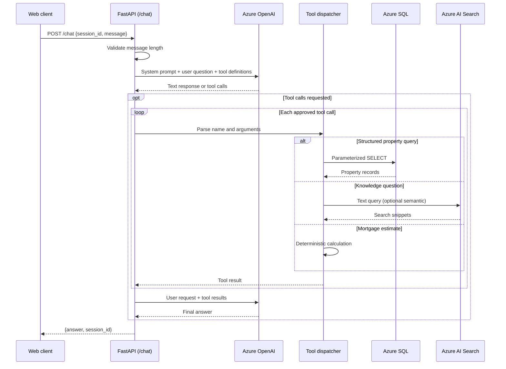
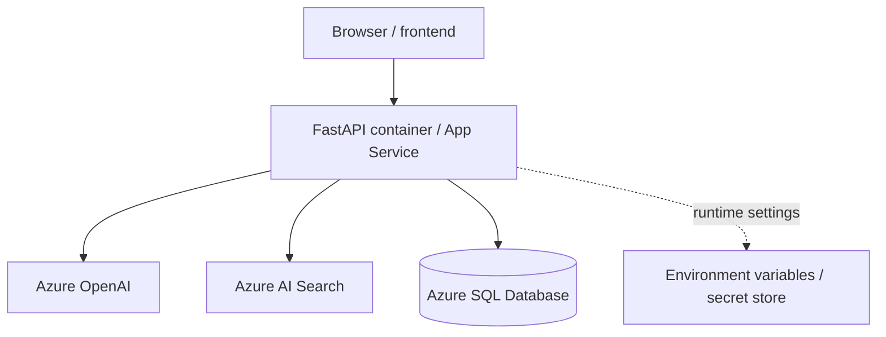

# Architecture and design decisions

This document describes the **code in this public repository**. Production-only features are noted separately in [implementation scope](implementation-scope.md).

## Public reference implementation

The chat workflow is implemented in `app/services/ai.py`. Tools are defined and dispatched in `app/tools/property_tools.py`.

## Why the boundaries matter

| Component | Role | Rationale |
| --- | --- | --- |
| Azure OpenAI | Choose tools, compose a conversational response | Natural-language interface; it is **not** the source of financial calculations or inventory facts |
| Azure SQL | Read property records and save leads | Structured queries and parameterized SQL |
| Azure AI Search | Retrieve indexed textual knowledge | Retrieval results can ground a response; this public code does not create embeddings or use vector queries |
| Python mortgage service | Calculate repayment estimates | Formula-based, repeatable output with a financial disclaimer |
| FastAPI / Pydantic | Validate HTTP inputs and expose OpenAPI docs | Explicit typed request boundaries |
| Environment configuration | Load resource values outside Git | Keeps credentials out of the public repository |

## Runtime deployment reference

This is a **logical deployment reference**, not an assertion that this repository includes infrastructure-as-code or an automated Azure deployment.

## Important omissions in this public code

- No per-tenant `tenant_id` scoping or authorization enforcement.
- No ingestion pipeline, embeddings generation, vector/hybrid search, or persisted document index definitions.
- No multi-turn session storage or session quota enforcement.
- No authentication, rate limits, or complete audit logging for public endpoints.
- No infrastructure-as-code or GitHub Actions Azure CD workflow.

These are intentional distinctions between a public educational reference and a production application. Do not deploy the reference version directly as a public business API without implementing these controls.
